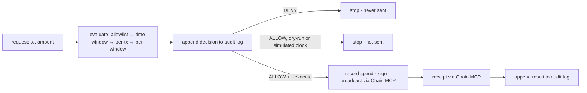

# Policy Gatekeeper — Medium

**Task:** [Policy Gatekeeper](https://pharos-agent-arena.vercel.app/tasks/policy-gatekeeper) (SkillEngine · Medium · 100 pts):
checks a requested action against spend limits, allowlists and time windows before executing.
**Run:** `npm run policy-gatekeeper -- <policy.json> (--to 0x… --amount 0.001 | --requests <file.json>) [--execute] [--proof]`
Without `--execute` or `--proof` a run is a dry-run: nothing is sent, and its decisions go to a scratch audit log (the path is
printed at the end), so trying the command never changes the committed proof log in `audit/`.
**Uses:** Chain MCP ✅ (only to send: nonce, gas, fees, broadcast, receipt; a denied request needs no chain call) · SkillEngine ✅ packaged as an
agent skill, [`skills/policy-gatekeeper/`](../../skills/policy-gatekeeper/SKILL.md) · Docs MCP: not used by this task

**Install as a skill:** `npx skills add https://github.com/edycutjong/pharos-beacon --skill policy-gatekeeper`.

## Requirements → evidence

| # | Arena requirement | How it is met | Evidence |
|---|---|---|---|
| 1 | A policy file or config with at least 3 rule types: spend limit, allowlist, time window | One JSON policy with `spendLimit` (per transaction and per rolling window), `allowlist` (recipient addresses, EOAs or contracts) and `timeWindow` (UTC hours, optional weekdays). Unknown fields, bad amounts, a mainnet network or an empty allowlist reject the whole policy | [`policies/treasury.json`](policies/treasury.json) · [`src/gatekeeper/policy.ts`](../../src/gatekeeper/policy.ts) |
| 2 | Every request returns allow or deny with the specific rule that decided it | Each request prints every rule's PASS/FAIL, then `=> ALLOW by …` or `=> DENY by <rule>`; the deciding rule is one of `allowlist`, `time_window`, `spend_limit_per_tx`, `spend_limit_per_window` or `request` (malformed input) | [Output below](#proof-live-runs) · [`src/gatekeeper/evaluate.ts`](../../src/gatekeeper/evaluate.ts) · [`proof/treasury.live.json`](proof/treasury.live.json) |
| 3 | Denied actions are never executed. Shows at least one deny per rule type | The only call to the sender is inside the allow branch of [`src/gatekeeper/run.ts`](../../src/gatekeeper/run.ts); a test makes every kind of deny with `--execute` and asserts the sender was never called. Live denies: allowlist, time window, per-tx limit, per-window limit, plus a malformed request | requests #2–#4, #6, #7 in [`proof/treasury.live.json`](proof/treasury.live.json) · real-clock time-window deny: [`proof/evening-only.denied.json`](proof/evening-only.denied.json) · `test/gatekeeper.test.ts` ("never calls send for a denied request") |
| 4 | Keeps an audit log of all decisions | Every decision, allow or deny, is appended to a JSONL log before anything is sent; each line carries the sha256 of the previous line, so an edited, removed or reordered line is detected. Executions add a `result` line with the tx hash and receipt | [`audit/audit.jsonl`](audit/audit.jsonl) (10 entries: 8 decisions, 2 results) |

Allowed requests were also executed on Atlantic testnet (not asked by the task, but it shows the gate opening):
[tx `0x80116098…69cd`](https://atlantic.pharosscan.xyz/tx/0x801160985556a2888c927db0109469d17f3a80b9b395baa5c30e49a060e969cd) and
[tx `0x90e9af74…e459`](https://atlantic.pharosscan.xyz/tx/0x90e9af7466fd8376509c291612e90fab7b607da7affd4bbf88dcec348f8ee459), both `success`, 21000 gas.

## What it does

A request is `{to, amount}` (PHRS). The gatekeeper checks it against the policy in a fixed order — allowlist, time window, per-transaction
limit, per-window limit — and the first failing rule is the deciding one; the others are still shown. A request it cannot read exactly
(bad address, amount that is not a positive decimal string, bad date) is denied under the rule `request`: it fails closed. Only an ALLOW
with `--execute` is sent, through the shared Atlantic signer (the Chain MCP prepares and broadcasts, viem signs locally). Mainnet is not
accepted: the policy's network must be `atlantic`.

The window budget is a rolling sum over `windowSeconds` of what this gatekeeper has let through, kept in `state/spend.json`. A spend is
written **before** the broadcast, so a send that then fails still counts against the limit (the limit errs on the side of having spent).
Two runs cannot interleave: the state file has a run lock. A request with `at` (ISO time) or `--at` is evaluated against that simulated
clock and is never sent.



## Chain MCP tools

| Tool | Used for |
|---|---|
| `get_chain_info` | chain check at connect (only when something is sent) |
| `get_transaction_count`, `get_block`, `estimate_gas`, `get_gas_price` | nonce, fees and gas for the transfer (shared signer) |
| `send_raw_transaction` | broadcast of the locally signed transfer |
| `get_transaction_receipt` | confirm `success`/`reverted` |

## Proof (live runs)

| Run | Network | Result | File |
|---|---|---|---|
| 7 requests against `treasury.json`, `--execute` (2026-10-17) | Atlantic 688689 | 2 allowed and sent, 5 denied (allowlist, time window, per-tx, per-window, malformed) | [`proof/treasury.live.json`](proof/treasury.live.json) |
| 1 request against `evening-only.json`, real clock 04:55 UTC, `--execute` | none needed | DENY by `time_window`, nothing sent | [`proof/evening-only.denied.json`](proof/evening-only.denied.json) |

Output of the first run (condensed: the other checks of each request are in the proof file):

```text
#1 allowed: allowlisted, small, inside the window: 0.001 PHRS → 0x8D347c72431ed6E033d5f43E56c0987E97f5D91B
  PASS allowlist · PASS time_window: 04:54 UTC is inside 00:00–12:00 UTC · PASS spend_limit_per_tx · PASS spend_limit_per_window
  => ALLOW by all_rules_passed (audit #1)
  tx executed: https://atlantic.pharosscan.xyz/tx/0x801160985556a2888c927db0109469d17f3a80b9b395baa5c30e49a060e969cd
#2 deny: recipient not on the allowlist: 0.001 PHRS → 0x000000000000000000000000000000000000dEaD
  FAIL allowlist: 0x000000000000000000000000000000000000dEaD is not on the allowlist (2 addresses)
  => DENY by allowlist (audit #3)
#3 deny: outside the UTC time window (simulated 18:30): … @ 2026-10-17T18:30:00Z
  FAIL time_window: 2026-10-17T18:30:00.000Z is outside the allowed window 00:00–12:00 UTC
  => DENY by time_window (audit #4)
#4 deny: over the per-transaction limit: 0.006 PHRS → 0x8D34…5D91B
  FAIL spend_limit_per_tx: 0.006 PHRS exceeds the per-transaction limit of 0.005 PHRS
  => DENY by spend_limit_per_tx (audit #5)
#5 allowed: second transfer uses most of the window budget: 0.004 PHRS → 0x317bca01Bb101C0F1E86C21576a4e14D92B02975
  => ALLOW by all_rules_passed (audit #6)
  tx executed: https://atlantic.pharosscan.xyz/tx/0x90e9af7466fd8376509c291612e90fab7b607da7affd4bbf88dcec348f8ee459
#6 deny: would push the hour over the window limit: 0.004 PHRS → 0x8D34…5D91B
  FAIL spend_limit_per_window: 0.004 PHRS on top of 0.005 PHRS already sent in the last 3600 s exceeds 0.008 PHRS
  => DENY by spend_limit_per_window (audit #8)
#7 deny: malformed request (fails closed): lots PHRS → 0x8D34…5D91B
  FAIL request: request: amount must be a decimal string with at most 18 decimals
  => DENY by request (audit #9)
summary: 7 requests · 2 allowed · 5 denied · 2 sent
audit log: 9 entries, hash chain intact
```

(`audit #N` is the line of the decision in the audit log; the lines in between are the `result` lines of the two sends.)
Re-running the same command today will not repeat this: the spend window in `state/spend.json` is already used, and the policy's
00:00–12:00 UTC window closes at noon. Use other file paths (`--state`, `--audit`, or the env vars `GATEKEEPER_STATE` / `GATEKEEPER_AUDIT`) for a fresh try.

A second, later run of the same 7 requests was recorded for the demo video with its own files, so it started with an empty window:
[`policies/treasury-recording.json`](policies/treasury-recording.json) is a byte-for-byte copy of `treasury.json`, with
[`state/recording.json`](state/recording.json) and [`audit/recording.jsonl`](audit/recording.jsonl) (9 entries, chain intact, 2 sends).

## Writing a policy

```json
{
  "name": "treasury-agent",
  "network": "atlantic",
  "spendLimit": { "perTx": "0.005", "perWindow": "0.008", "windowSeconds": 3600 },
  "allowlist": ["0x8D347c72431ed6E033d5f43E56c0987E97f5D91B", "0x317bca01Bb101C0F1E86C21576a4e14D92B02975"],
  "timeWindow": { "start": "00:00", "end": "12:00", "days": [1, 2, 3, 4, 5] }
}
```

Every rule is optional but at least one is required. Amounts are decimal strings in PHRS (never floats, at most 18 decimals).
`timeWindow` is UTC, start inclusive and end exclusive; `start` later than `end` wraps over midnight, and `days` (0 = Sunday)
then refers to the day the window started on. `--requests file.json` runs an array of `{label?, to, amount, at?}` in order.
Exit code: 0 when every request was handled as the policy says (a deny is a correct answer), 1 for a revert or an error, 2 for bad
input, 3 for a deny when `--fail-on-deny` is set.

## Limits (stated plainly)

- The spend window and the audit log are local files. Anyone with write access to the machine can edit the state (the audit log
  detects edits and reordering, but a truncated tail is not detectable by a hash chain alone) or send from the key directly.
  This is a gate for an agent that goes through it, not a custody control.
- The window counts only transfers this gatekeeper sent. Native PHRS transfers only; token transfers and contract calls are not
  modelled. The allowlist can name contracts, but nothing about the call data is checked.
- The time-window deny in `treasury.live.json` (#3) uses a simulated clock; the real-clock time-window deny is the
  `evening-only` run. The proofs were produced from the working tree before this task's commit (`meta.git.dirty` is true).
- A send whose broadcast is refused still counts toward the window (the spend is recorded first).
- A dry-run batch counts its own earlier ALLOWs toward the window (in memory, not saved), so it predicts what `--execute` would do.

## Tests

`npm test` runs 45 tests for this task (`test/gatekeeper.test.ts`, `test/gatekeeper-cli.test.ts`): policy parsing and every rejection,
each rule's boundaries (limit exactly met, window start and end, midnight wrap, weekdays, spend aging out of the window), a deny per rule
type, malformed requests, "send is never called for a deny", a dry-run batch accumulating its own spend, state persisted across runs and refused when corrupt, a failed send still
counting, the audit chain detecting an edit / removal / reorder, and the real CLI process (exit codes, no chain reachable, dry-run).
