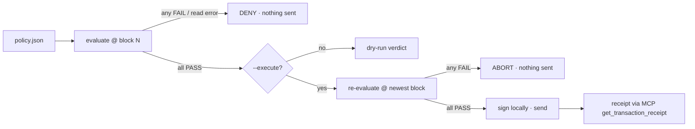

# Threshold Guardian — Medium

**Task:** a skill that evaluates multiple onchain conditions before an action executes
(the example Medium task in the Season of AI announcement; re-check against the board wording when it opens).
**Run:** `npm run guard -- tasks/threshold-guardian/policies/<policy>.json [--execute] [--proof]`
**Uses:** Chain MCP ✅ · Docs MCP — · SkillEngine — (network config and token addresses come from SkillEngine's `assets/`)

## What it does
You describe a guarded action as a JSON policy: a list of conditions and one action. The Guardian reads every
condition live through the Pharos Chain MCP, pins all reads to one block, and allows the action only when every
condition passes. If a read fails, the check fails and the action is denied. With `--execute` it evaluates the
policy again at the newest block right before signing, so a condition that changed in between still stops the
send. It then confirms the receipt through the same MCP.



## Conditions → Chain MCP tools

| `kind` | What it checks | Chain MCP tool |
|---|---|---|
| `native_balance` | PROS / PHRS balance vs threshold | `get_balance` |
| `erc20_balance` | token balance vs threshold, decimals read on-chain | `eth_call` (`balanceOf`, `decimals`) |
| `gas_price` | current gas price vs a gwei ceiling | `get_gas_price` |
| `is_contract` | address has (or has no) bytecode | `get_code` |
| `nonce_settled` | no pending transaction stuck for the address | `get_transaction_count` (latest + pending) |
| `log_activity` | event count from a contract in the last N ≤ 1000 blocks | `get_logs` |
| (block pin, receipt) | | `get_block_number`, `get_transaction_receipt` |

That's 9 Chain MCP tools in use. Mainnet reads go to the hosted keyless server
`https://mcp.pharos.xyz/mcp`. The hosted server only serves mainnet, so Atlantic testnet reads go to the same
open-source server ([PharosNetwork/pharos-mcp](https://github.com/PharosNetwork/pharos-mcp), pinned commit) run
locally over stdio and pointed at the testnet RPC (`npm run setup:mcp` builds it). Actions are native transfers on
Atlantic testnet only. Mainnet policies are dry-run by design, and the schema rejects a mainnet action.

## Proof (live runs, 2026-10-11)

| Policy | Network | Result | Evidence |
|---|---|---|---|
| `wpros-watch.json` | Pharos mainnet | ALLOW 4/4 → dry-run (WPROS backing 23.38M PROS, 109 USDC transfers in 1000 blocks, 10 gwei) | [`proof/wpros-watch.dry-run.json`](proof/wpros-watch.dry-run.json) |
| `pay-when-safe-deny.json` | Atlantic | DENY 4/5 (reserve 1000 PHRS > 14.99 held) → nothing sent | [`proof/pay-when-safe-deny.denied.json`](proof/pay-when-safe-deny.denied.json) |
| `pay-when-safe.json` | Atlantic | ALLOW 5/5 → re-check ALLOW → 0.001 PHRS sent, `success` in block 31252331 | [tx `0x0fda4e6f…5b50`](https://atlantic.pharosscan.xyz/tx/0x0fda4e6f656566e65b2067d0d34492bb49449b873f7faa3bb8eda9f0daea5b50) · [`proof/pay-when-safe.executed.json`](proof/pay-when-safe.executed.json) |

## Writing a policy

```json
{
  "name": "pay-when-safe",
  "network": "atlantic",
  "conditions": [
    { "kind": "native_balance", "address": "$SELF", "op": "gte", "value": "1" },
    { "kind": "gas_price", "op": "lte", "gwei": "50" },
    { "kind": "is_contract", "address": "0x8D34…D91B", "expect": false }
  ],
  "action": { "type": "native_transfer", "to": "0x8D34…D91B", "amount": "0.001" }
}
```

`op` is one of `gte gt lte lt eq`. Amounts are decimal strings in whole units, never floats. `"$SELF"` is the
signing wallet. Every field is validated before any read happens (`src/guardian/policy.ts`).

- Video: _pending (human records + posts for the +50 bonus)_
