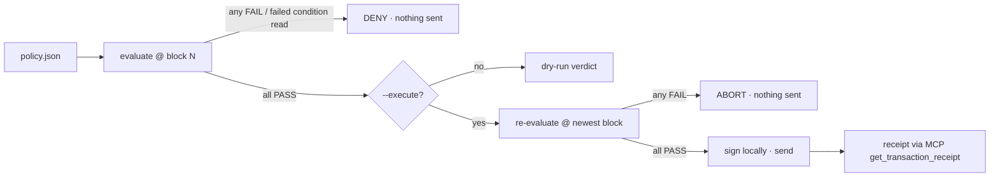

# Threshold Guardian — Medium

**Task:** [Threshold Guardian](https://pharos-agent-arena.vercel.app/tasks/threshold-guardian) (SkillEngine · Medium · 100 pts):
evaluates multiple on-chain conditions before deciding whether to fire an action at all.
**Run:** `npm run guard -- tasks/threshold-guardian/policies/<policy>.json [--execute] [--proof]`
**Uses:** Chain MCP ✅ (all condition reads + receipt) · SkillEngine ✅ packaged as an agent skill,
[`skills/threshold-guardian/`](../../skills/threshold-guardian/SKILL.md) (network config in `src/lib/networks.ts` is
copied from SkillEngine's `assets/`) · Docs MCP: not used by this task

**Install as a skill:** `npx skills add https://github.com/edycutjong/pharos-beacon --skill threshold-guardian`. An agent
then turns "only do X if A, B and C hold" into a policy, dry-runs it, explains the trace, and executes only on
confirmation.

## Requirements → evidence

| # | Arena requirement | How it is met | Evidence |
|---|---|---|---|
| 1 | Evaluates at least 3 independent conditions read from chain | 6 condition kinds, each its own Chain MCP read ([table below](#conditions--chain-mcp-tools)). The mainnet policy has 4 conditions and the Atlantic policy has 5 | [`proof/wpros-watch.dry-run.json`](proof/wpros-watch.dry-run.json) · [`proof/pay-when-safe.executed.json`](proof/pay-when-safe.executed.json) |
| 2 | Conditions and thresholds are configurable, not hard-coded | A JSON policy sets every kind, operator, threshold, address and the action; `src/guardian/policy.ts` validates it before any read ([Writing a policy](#writing-a-policy)) | [`policies/`](policies/) · [`src/guardian/policy.ts`](../../src/guardian/policy.ts) |
| 3 | Logs a clear decision trace each run: each condition's value, pass/fail and the final decision | One `PASS`/`FAIL` line per condition with the observed value and the threshold, then `=> ALLOW` or `=> DENY`; `--proof` saves the full trace as JSON | [Output of the executed run](#proof-live-runs) · [`src/guardian/evaluate.ts`](../../src/guardian/evaluate.ts) |
| 4 | Demonstrates both outcomes: one run where it fires and one where it holds | Fires: ALLOW 5/5, re-check ALLOW, 0.001 PHRS sent, receipt `success`. Holds: DENY 4/5, nothing sent. The hold comes from a second policy whose reserve the wallet cannot meet, not from a market move | tx [`0xd567073e…bf39`](https://atlantic.pharosscan.xyz/tx/0xd567073eaa5d89eb5e30c3e3efa2948818851648fe628d93ff6fa29074dfbf39) · [`proof/pay-when-safe-deny.denied.json`](proof/pay-when-safe-deny.denied.json) |

## What it does
You describe a guarded action as a JSON policy: a list of conditions and one action. The Guardian reads every
condition live through the Pharos Chain MCP and allows the action only when every condition passes. State reads
(balances, `eth_call`, code, logs) are pinned to the block number fetched at the start of the evaluation. Gas price
is read live, because `get_gas_price` takes no block argument. The nonce pair is read at the `latest` and `pending`
tags, since `pending` cannot be pinned to a block number. If a condition's read fails, that check fails and the action
is denied; if the MCP cannot be reached at all, the run stops with an error and nothing is sent. With `--execute` it
evaluates the policy again at the newest block right before signing, so a condition that changed in between still
stops the send. A short gap remains between that re-check and the broadcast, while viem estimates gas and signs. It
then confirms the receipt through the same MCP. A reverted transfer is reported as `reverted` with exit code 1, not
as success.



## Conditions → Chain MCP tools

| `kind` | What it checks | Chain MCP tool |
|---|---|---|
| `native_balance` | PROS / PHRS balance vs threshold | `get_balance` |
| `erc20_balance` | token balance vs threshold, decimals read on-chain | `eth_call` (`balanceOf`, `decimals`) |
| `gas_price` | current gas price vs a gwei ceiling | `get_gas_price` |
| `is_contract` | address has (or has no) bytecode | `get_code` |
| `nonce_settled` | no pending transaction stuck for the address | `get_transaction_count` (latest + pending) |
| `log_activity` | event count from a contract in the last N ≤ 1000 blocks | `get_logs` |
| (block pin, receipt) | | `get_block_number`, `get_transaction_receipt` |

That's 8 of the Chain MCP's 13 read tools (`src/guardian/reader.ts`); the client also calls `get_chain_info` when it
connects, to check that the endpoint serves the policy's chain. Mainnet reads go to the hosted keyless server
`https://mcp.pharos.xyz/mcp`. That server only serves mainnet, so Atlantic testnet reads use the open-source server
code ([PharosNetwork/pharos-mcp](https://github.com/PharosNetwork/pharos-mcp), commit `9a3750c`) run locally over
stdio and pointed at the testnet RPC (`npm run setup:mcp` builds it). The child process gets a minimal environment
(`PATH` and the other safe defaults the MCP SDK passes, plus the `PHAROS_*` settings and
`ENABLE_SEND_RAW_TRANSACTION=false`), never `PRIVATE_KEY`. Actions are
native transfers on Atlantic testnet only. Mainnet policies are dry-run by design, and the schema rejects a mainnet
action.

## Proof (live runs)

| Policy | Network | Result | Evidence |
|---|---|---|---|
| `wpros-watch.json` | Pharos mainnet | ALLOW 4/4 → dry-run (2026-10-10) | [`proof/wpros-watch.dry-run.json`](proof/wpros-watch.dry-run.json) |
| `pay-when-safe-deny.json` | Atlantic | DENY 4/5 (needs a 1000 PHRS reserve, wallet holds 14.98) → nothing sent (2026-10-16) | [`proof/pay-when-safe-deny.denied.json`](proof/pay-when-safe-deny.denied.json) |
| `pay-when-safe.json` | Atlantic | ALLOW 5/5 → re-check ALLOW → 0.001 PHRS sent, `success` in block 31482903 (2026-10-16) | [tx `0xd567073e…bf39`](https://atlantic.pharosscan.xyz/tx/0xd567073eaa5d89eb5e30c3e3efa2948818851648fe628d93ff6fa29074dfbf39) · [`proof/pay-when-safe.executed.json`](proof/pay-when-safe.executed.json) |

Earlier runs of the same policy (2026-10-10):
[tx `0xfa437f21…dff8`](https://atlantic.pharosscan.xyz/tx/0xfa437f21fb7dd6ef66f5915ce4cff7f7e032cf110d709b79f5d52ad64deddff8) (block 31252509) and
[tx `0x0fda4e6f…5b50`](https://atlantic.pharosscan.xyz/tx/0x0fda4e6f656566e65b2067d0d34492bb49449b873f7faa3bb8eda9f0daea5b50) (block 31252331).

In the executed run the re-check landed in the same block as the first check because the chain had not advanced
yet. It is still a second, independent set of MCP reads. The block below omits the final `proof: <path>` line that
`--proof` prints.

The abort path (a condition flips between the first check and the send) is covered by a unit test
(`test/guard.test.ts`, "aborts when a condition flips between check and send"). It has not been shown live.

Output of the executed run:

```text
pay-when-safe @ atlantic block 31482902
  PASS  payer keeps a 1 PHRS reserve: 14.983133064 PHRS (need >= 1 PHRS)
  PASS  gas is not spiking: 10 gwei (need <= 50 gwei)
  PASS  recipient is a plain wallet, not a contract: no code (need no code)
  PASS  payer has no stuck transaction: nonce latest 8 / pending 8 (need latest == pending)
  PASS  WPHRS wrapper is backed by at least 1000 PHRS: 150993019.075259610098101382 PHRS (need >= 1000 PHRS)
  => ALLOW (5/5 conditions pass)
  re-checked at block 31482902: ALLOW → broadcast 0.001 PHRS transfer
  tx success in block 31482903: https://atlantic.pharosscan.xyz/tx/0xd567073eaa5d89eb5e30c3e3efa2948818851648fe628d93ff6fa29074dfbf39
status: executed
```

The DENY run prints `FAIL  payer keeps a 1000 PHRS reserve (wallet holds less, so this must block): 14.982112064 PHRS (need >= 1000 PHRS)` and
`=> DENY (4/5 conditions pass)`. It sends nothing and exits 1.

## Writing a policy

```json
{
  "name": "pay-when-safe",
  "network": "atlantic",
  "conditions": [
    { "kind": "native_balance", "address": "$SELF", "op": "gte", "value": "1" },
    { "kind": "gas_price", "op": "lte", "gwei": "50" },
    { "kind": "is_contract", "address": "0x8D347c72431ed6E033d5f43E56c0987E97f5D91B", "expect": false }
  ],
  "action": { "type": "native_transfer", "to": "0x8D347c72431ed6E033d5f43E56c0987E97f5D91B", "amount": "0.001" }
}
```

A shortened version of [`policies/pay-when-safe.json`](policies/pay-when-safe.json). `op` is one of `gte gt lte lt eq`.
Amounts are decimal strings in whole units, never floats. `"$SELF"` is the signing wallet, so a policy that uses it
needs `PRIVATE_KEY` set even for a dry-run, and it works on Atlantic only (a signer exists only there, so on mainnet
a `$SELF` condition always fails). Before any read, `src/guardian/policy.ts` validates the network, each
condition's kind, addresses (mixed-case addresses must have a valid checksum), operators, amounts, the log window
(1–1000 blocks) and the action. A transfer amount must be greater than 0. Amounts and thresholds may not carry more
decimal places than their unit (18 for PROS/PHRS, 9 for gwei), so nothing is rounded silently. An ERC-20 threshold is
checked against the token's own `decimals()` when the token is read, and a finer threshold fails the check.
